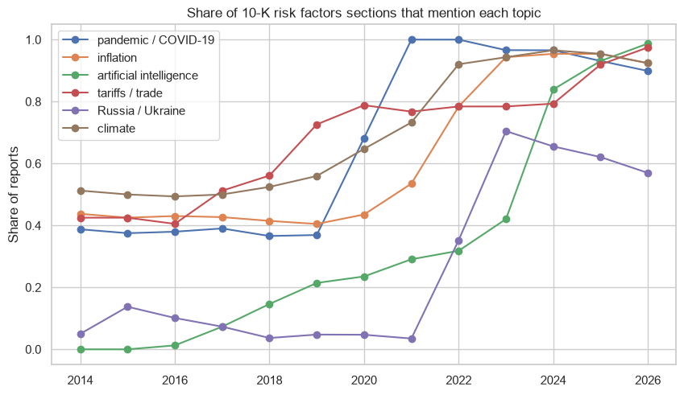
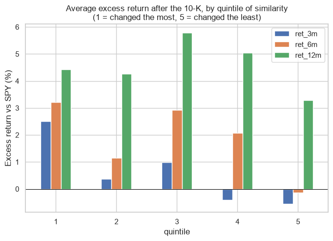

# Lazy prices: do changes in the 10-K risk factors predict returns?

Cohen, Malloy and Nguyen (2020, *Journal of Finance*) found that companies that change their annual report a lot from one year to the next have lower returns in the following months, and that the market is slow to notice ("lazy prices"). Here the idea is tested with **Item 1A. Risk Factors** of the 10-K reports of 92 of the biggest US companies, 2014 to 2026: 1.087 reports and 992 pairs of consecutive years.

**Measures of change:**
- TF-IDF cosine
- Jaccard
- share of new sentences
- cosine of `multilingual-e5-small` embeddings

**Returns:** excess returns against SPY at 1 week, 3, 6 and 12 months, by quintiles and with regressions (year fixed effects, errors clustered by company).

**Data:** SEC EDGAR (full text of the 10-K reports) and Yahoo Finance.

## Results
- **The risk factors change every year and follow the news.**
  - About a third of the sentences are new each year (46% in 2021).
  - The section grew from 8.400 to 14.300 words (median).

| Share of reports that mention... | 2014-2019 | 2023 | 2026 |
|---|---|---|---|
| Artificial intelligence | 0% to 21% | 42% | 99% |
| Inflation | about 42% | 94% | 92% |
| Russia / Ukraine | 3% to 14% | 70% | 57% |
| Tariffs | 42% to 73% | 78% | 97% |

- **No lazy prices in this sample.**
  - The 12-month return of the non-changers minus the changers is -1.2%, with a bootstrap interval from -6.4% to +3.9%.
  - No measure predicts the 6 or 12 month return.
  - At 1 week and 3 months the changers did a little better (t-statistics around 2), the opposite sign of the paper. With 16 tests this is weak evidence.
- **Why the difference:** the paper used all US firms, small ones included, from 1995 to 2014. Here there are only mega caps, followed by many analysts, from 2015 to 2026, after the paper was published.
- **Method:** the average embedding of a long section almost does not move (cosine 0.994). Word and sentence measures show the change much better.




## How to run
```
pip install -r requirements.txt
python download_10k.py      # about 1.200 reports from SEC EDGAR, keeps only Item 1A (100 MB of text)
python get_prices.py
jupyter notebook lazy_prices.ipynb
```

---
Alejandro Lezcano Osorio | Rennes School of Business (MSc in Financial Data Intelligence) and Universidad EIA
